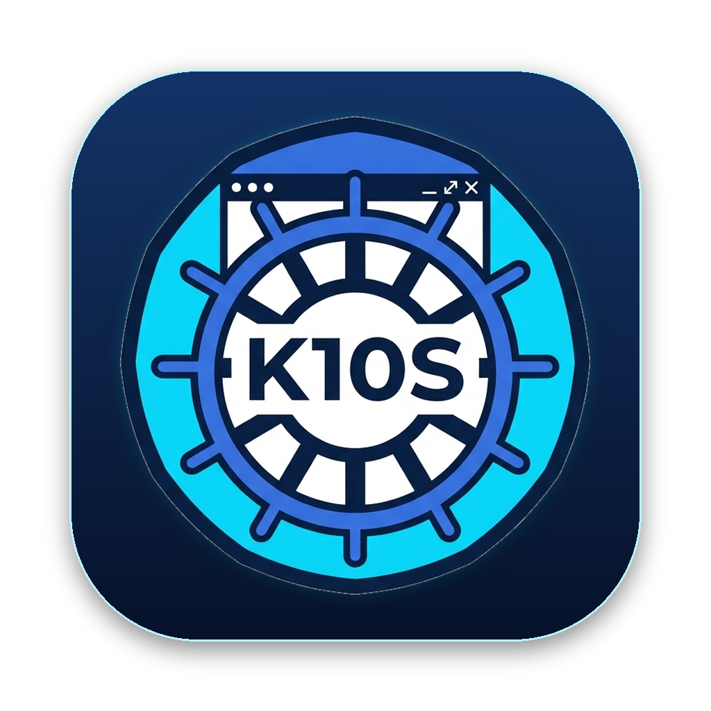

<p align="center"></p>

# K10S

A desktop app for Kubernetes. It does what [k9s](https://github.com/derailed/k9s) does, with a clickable UI on top. Mac first.

It uses your existing kubeconfig, so any cluster `kubectl` can reach works in K10S.

## Features

- Browse every resource type, CRDs included, with live updates, sorting and filtering
- Drill down from deployments, services, jobs and nodes to their pods
- YAML, describe and events for any object
- Live logs: pick a container, follow, view previous runs, search
- Shell into containers
- Edit YAML, delete, restart, scale, trigger CronJobs, cordon nodes
- Port-forward to pods, services and deployments
- CPU and memory usage (needs metrics-server)
- k9s keyboard shortcuts: `:` command bar, `/` filter, `?` for the full list
- **Read-only by default.** You unlock changes from the sidebar, and every change asks for confirmation

## Setup

### Requirements

- macOS (Apple Silicon or Intel)
- [Go](https://go.dev/dl/) 1.26 or newer
- [Node.js](https://nodejs.org/) 20.19 or newer
- Xcode Command Line Tools: `xcode-select --install`
- A working kubeconfig (`kubectl get pods` should work)

### Install the Wails CLI

```bash
go install github.com/wailsapp/wails/v2/cmd/wails@latest
```

Make sure `$(go env GOPATH)/bin` is on your `PATH`, then check your setup:

```bash
wails doctor
```

### Run in development

```bash
cd app
wails dev
```

The app opens with hot reload. Frontend changes apply instantly, and Go changes trigger a rebuild.

### Build the app

```bash
cd app
wails build -platform darwin/arm64     # Apple Silicon
wails build -platform darwin/amd64     # Intel
wails build -platform darwin/universal # both
open build/bin/K10S.app
```

Drag `build/bin/K10S.app` into `/Applications` to install it.

## Cluster auth

K10S reads `~/.kube/config`, or the files listed in `$KUBECONFIG`, the same way `kubectl` does. Exec-based auth plugins such as `gke-gcloud-auth-plugin`, `aws` and `kubelogin` work as long as they're installed in `/opt/homebrew/bin`, `/usr/local/bin` or the Google Cloud SDK `bin` folder. Apps opened from Finder don't inherit your shell's `PATH`, so K10S looks in those folders.

If you see a credentials error, sign in again with your cloud CLI (for example `gcloud auth login`) and reopen the app.

## Project layout

```
app/
  main.go, app.go      Wails entry point and cluster client setup
  resources.go         Resource discovery, server-side tables, watches, metrics
  objects.go           YAML, describe, events, drill-down, secrets
  actions.go           Restart, scale, cordon, CronJob trigger and suspend
  logs.go, shell.go    Log streaming and interactive exec
  portforward.go       Port-forwarding
  frontend/            React + TypeScript UI (Vite)
```

## Tests

```bash
cd app
go test -run TestSmoke -v .   # read-only checks against your current context
```

`TestMutations` runs every change action, so it only runs against a throwaway [kind](https://kind.sigs.k8s.io/) cluster:

```bash
kind create cluster --name k10s-test --kubeconfig /tmp/k10s.kubeconfig
export KUBECONFIG=/tmp/k10s.kubeconfig
kubectl create deployment web --image=nginx:alpine --replicas=2
kubectl create cronjob tick --image=busybox --schedule="0 0 1 1 *" -- echo tick
kubectl create secret generic demo --from-literal=password=example
cd app && K10S_TEST_KUBECONFIG=/tmp/k10s.kubeconfig go test -run TestMutations -v .
kind delete cluster --name k10s-test
```
